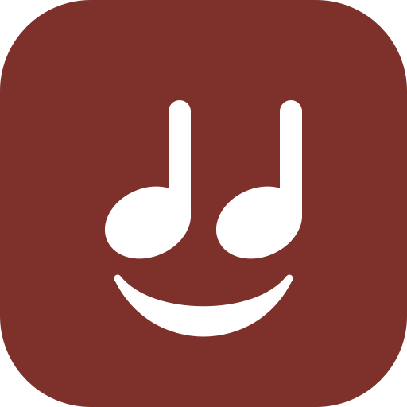

<p align="center">
  
</p>

<h1 align="center">Legato</h1>

<p align="center">
  A music player for the music you own: on your computer, your phone and your watch.<br>
  Your files are the library. No server, no account, no streaming.
</p>

<p align="center">
  <a href="https://github.com/sloporation/legato/actions/workflows/build.yml"></a>
  <a href="https://github.com/sloporation/legato/releases/latest"></a>
</p>

---

Legato looks after the music in folders you choose. The tags in the files say what each song is, and playlists are the `.m3u` and
`.m3u8` files beside them, so Legato keeps no database of its own and your library stays readable by any other player. Plug a
phone in and Legato puts your choice of music on it over USB, with nothing in between: no server, no network, no cloud.

| | |
|---|---|
| **Legato Desktop** | macOS, Linux and Windows (Qt 6, QML) |
| **Legato for iPhone** | iOS 17 and later (SwiftUI), with **Legato for Apple Watch** (watchOS 10) |
| **Legato for Android** | Android 8.0 and later (Jetpack Compose, Media3) |

## Features

**Legato Desktop**

- Artists, Albums and Songs, with album pages and a sortable table of every track, and Find (Cmd/Ctrl+F) to narrow it
- Edit the tags of one song or many at once (Cmd/Ctrl+I): title, artist, album, genre, year, track and disc numbers. The changes
  are written into the files themselves
- Playlists are `.m3u8` files in your music folder: make one with +, and drag songs onto it in the sidebar
- Notices new, changed and removed files on its own, and keeps a cache of tags so a large library opens in moments
- Syncs to iPhones and Android phones over USB. You choose everything, or some playlists, artists and albums, and only
  what's new or changed is copied. Files the phone can't play (Opus on an iPhone, for example) are converted to AAC on the way,
  with ffmpeg

**Legato for iPhone and Android**

- Your synced music in two tabs: Music (every song, searchable) and Playlists
- Long-press a song to go to its album, its artist or a playlist it's in, or to add it to a playlist
- Make, rename and delete playlists, and add, remove and reorder songs. The changes go back to the desktop at the next sync
- Lock-screen and headphone controls, shuffle and repeat, and AirPlay on the iPhone
- **Apple Watch:** choose music on the iPhone to send to the watch, then play it there without the phone

## How syncing works

Everything Legato puts on a phone lives in one folder, `Legato/`: the music files, the album covers, and a `manifest.json`
describing the tracks and playlists.

- **iPhone:** Legato Desktop writes into Legato for iPhone's own Documents folder through usbmuxd (the system service Finder and
  Xcode use), with libimobiledevice. The phone has to trust the computer once.
- **Android:** the phone shows up as a drive (its USB setting "File transfer"), and Legato Desktop writes `Music/Legato` with
  libmtp. On first launch Legato for Android asks you to choose that folder, as Android requires.
- **Apple Watch:** the iPhone sends the music you choose with WatchConnectivity.

A sync copies files first and writes the manifest last, so a cable pulled halfway never leaves the phone with a library it can't
play. Playlist changes made on the phone are kept in `Legato/changes.json` until the next sync takes them back to the desktop's
playlist files. [docs/sync.md](docs/sync.md) describes the format in full.

## Download

Packages for every platform are attached to each [release](https://github.com/sloporation/legato/releases):

| | |
|---|---|
| macOS | `Legato-<version>-macOS.dmg` |
| Linux | `Legato-<version>-Linux-x86_64.AppImage` |
| Windows | `Legato-<version>-Windows-x64.zip` |
| Android | `Legato-<version>-Android.apk` |

The macOS app is not notarized yet: the first time, right-click Legato.app and choose Open. Legato for iPhone isn't on the App
Store, so build it from source (below). The Windows build can't sync to phones yet.

## Building from source

### Legato Desktop

You need CMake, Qt 6.5 or later (Quick, QuickControls2, Multimedia, Network), TagLib 2 and libyaml. For syncing to phones,
add pkg-config with libimobiledevice and libmtp. They're optional: without them the app builds without syncing to that kind
of phone. ffmpeg is used at runtime, if it's installed, to convert what a phone can't play.

**macOS**

```bash
brew install qt taglib libyaml pkgconf libimobiledevice libmtp ffmpeg
```

```bash
./build-qt.sh
```

**Linux (Debian, Ubuntu)**

```bash
sudo apt install qt6-base-dev qt6-declarative-dev qt6-multimedia-dev libyaml-dev pkg-config libimobiledevice-dev libmtp-dev ffmpeg
```

```bash
cmake -S qt -B qt/build && cmake --build qt/build && ./qt/build/legato
```

That needs a distribution with Qt 6.5 or later and TagLib 2, such as Debian 13 or Ubuntu 25.04. On Ubuntu 24.04, which has Qt
6.4 and TagLib 1.x, install Qt with [aqtinstall](https://github.com/miurahr/aqtinstall) and build TagLib from source, as
[the CI workflow](.github/workflows/build.yml) does. Syncing to an iPhone needs the `usbmuxd` service running.

**Windows**

```powershell
vcpkg install taglib:x64-windows libyaml:x64-windows
```

```powershell
cmake -S qt -B build -DCMAKE_TOOLCHAIN_FILE="$env:VCPKG_INSTALLATION_ROOT/scripts/buildsystems/vcpkg.cmake"
```

```powershell
cmake --build build --config Release
```

Settings are kept in `legato.yaml`, in `~/.config/legato/` on macOS and Linux and `%APPDATA%\legato\` on Windows. The Open in
Editor button in Settings opens it, and edits made by hand are picked up when you save.

### Legato for iPhone and Apple Watch

You need Xcode 16 or later and [XcodeGen](https://github.com/yonaskolb/XcodeGen). The Xcode project is generated from
`ios/project.yml` and isn't kept in git.

```bash
brew install xcodegen
```

```bash
cd ios && xcodegen generate && open Legato.xcodeproj
```

To run it on your own iPhone, choose your team in the Legato target's Signing & Capabilities (or set `DEVELOPMENT_TEAM` in
`project.yml`), then build the Legato scheme to your phone. The watch app comes with it.

### Legato for Android

You need JDK 17 or later and the Android SDK (Android Studio installs both).

```bash
cd android && ./gradlew assembleDebug
```

```bash
adb install -r android/app/build/outputs/apk/debug/app-debug.apk
```

Or open `android/` in Android Studio and run it.

## Releases

[`.github/workflows/build.yml`](.github/workflows/build.yml) builds all of it on every push and pull request to `dev`: the
desktop app for macOS, Linux and Windows, the Android APK, and the iPhone and watch apps, with the tests. Pushing a tag makes a
release with the packages attached:

```bash
git tag v0.1.0 && git push origin v0.1.0
```

The Android APK is signed with a release key when the repository has the secrets `ANDROID_KEYSTORE_BASE64`,
`ANDROID_KEYSTORE_PASSWORD`, `ANDROID_KEY_ALIAS` and `ANDROID_KEY_PASSWORD`, and with the debug key otherwise.

## Project layout

```
qt/          Legato Desktop: C++ in the top folder, QML in qml/, the config file reader (C) in core/
ios/         Legato for iPhone (Legato/), for Apple Watch (LegatoWatch/), the code they share (Shared/), and the tests
android/     Legato for Android
docs/        sync.md: what's on a phone, and how syncing works
branding/    icon.svg, the one source for every app's icon, and export.sh, which renders it for each
```

## Still to come

- Legato for Wear OS
- An equaliser on the phones
- Syncing song info edited on a phone back to the desktop (playlists already go back)
- Syncing to phones from Windows
